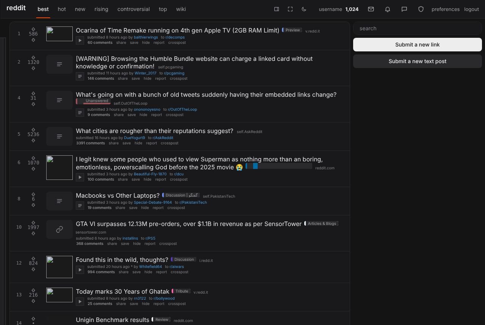
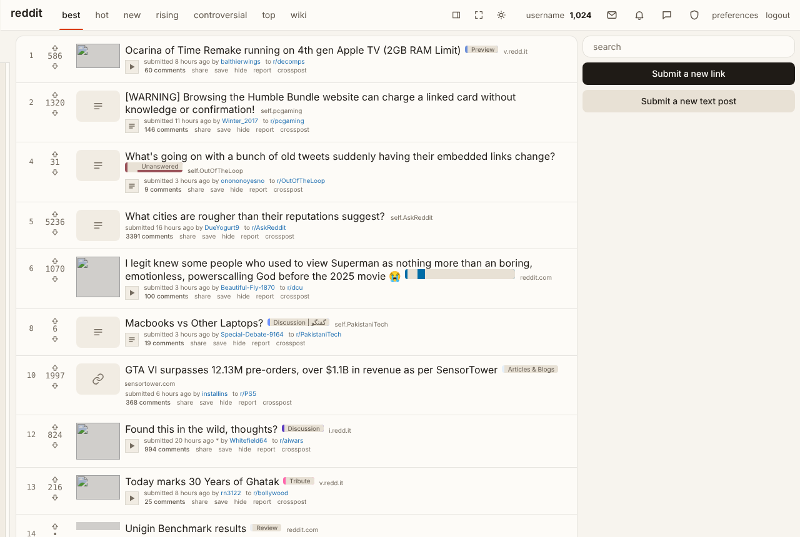
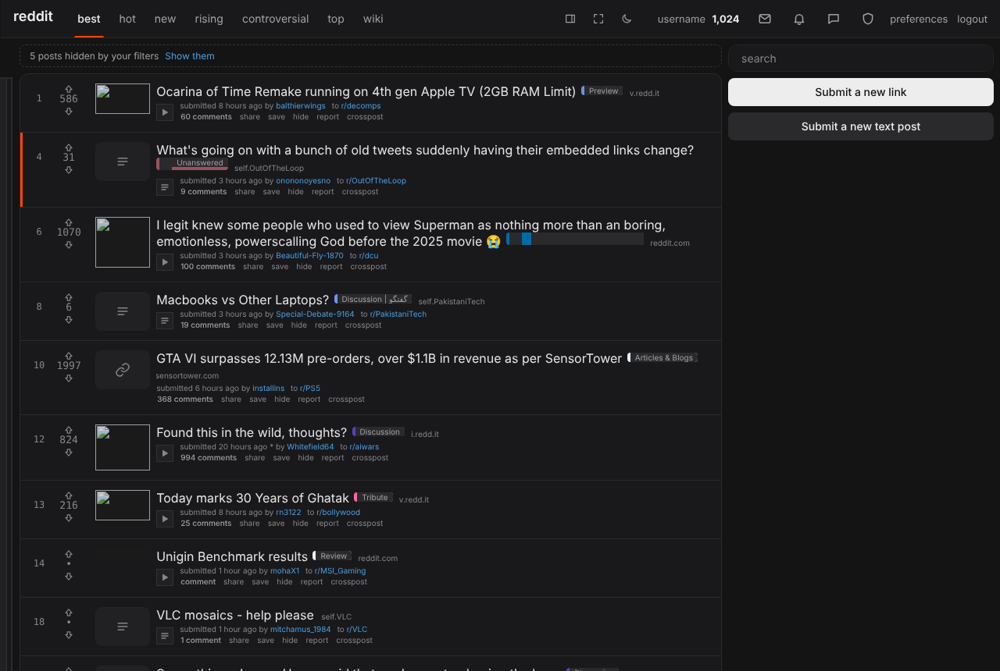
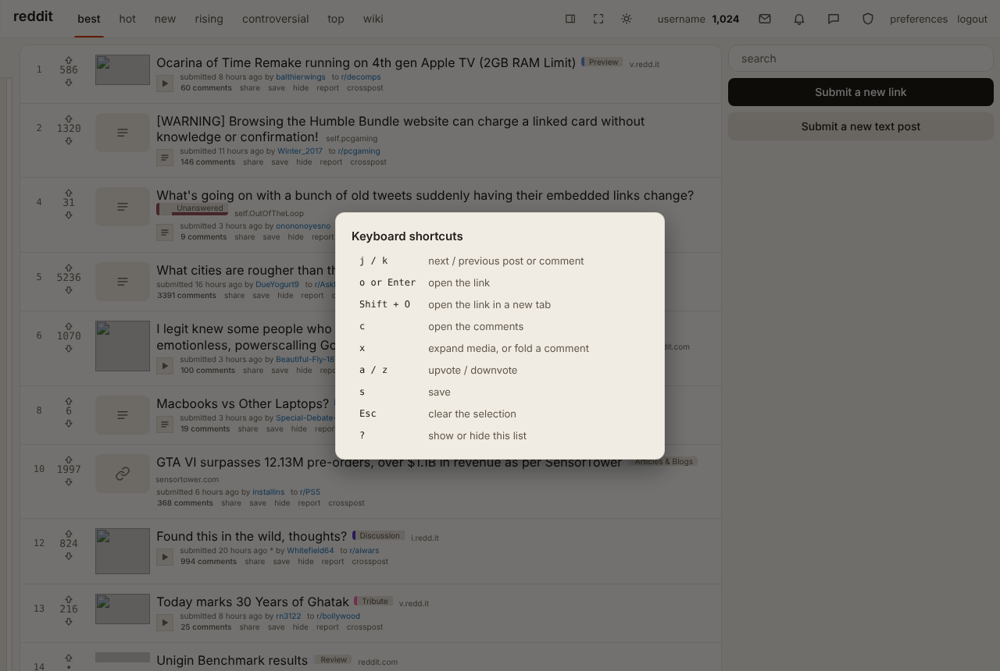

<h1 align="center">bettereddit</h1>

<p align="center">A calm, modern look for <b>old.reddit.com</b>. Old reddit stays old reddit: same dense list, same tabs, same sidebar. No cards, no avatars, no redesign.</p>

<p align="center">
  
  
</p>

It comes in two versions. Pick one, not both, or the page gets styled twice.

| | Userstyle | Firefox extension |
|---|---|---|
| What it is | A theme for the Stylus add-on | A standalone add-on |
| Browsers | Firefox, Chrome, Edge, anything with Stylus | Firefox 128 or newer |
| Theme and layout fixes | ✓ | ✓ |
| Reading features, filters, keyboard | | ✓ |
| Settings | Stylus options page | Toolbar popup, changes apply live |
| Updates | Automatic, from this repo | Manual for now |

## Contents

- [Theme features (both versions)](#theme-features-both-versions)
- [Extension-only features](#extension-only-features)
- [Install the userstyle](#install-the-userstyle)
- [Install the extension](#install-the-extension)
- [Keyboard shortcuts](#keyboard-shortcuts)
- [Using it with RES](#using-it-with-res)
- [Privacy and permissions](#privacy-and-permissions)
- [Building from source](#building-from-source)
- [Disclaimer](#disclaimer)
- [Credits](#credits)
- [License](#license)

## Theme features (both versions)

**Look**
- Two palettes. **Carbon** is a dark graphite. **Paper** is a warm light. You can also follow your system's light or dark setting.
- Choose your own accent, link, downvote, title and visited-title colors.
- One icon set, drawn by the theme. Votes, expand buttons, mail, notifications, chat and mod mail all match.
- Flair shows as a neutral label with the subreddit's color as a thin edge. You can switch to full subreddit colors, or hide flair.

**Text**
- Fonts: Inter (if it's installed), your system font, Verdana like classic reddit, or any installed font by name.
- A separate code font, if you want one.
- Adjustable text size and line height for posts and comments.
- Comfortable or compact post lists.
- Post and comment text can use the full width.

**Comments**
- The post author's comments are marked.
- Mod and admin comments are marked.
- Optional colored thread lines, one color per depth.
- Bigger `[–]` buttons for collapsing.

**Page**
- Bigger images and videos, up to the window height.
- Optional sticky header.
- Optional: hide the subreddit bar at the top, the sidebar on comment pages, or show "users here now" everywhere.
- Thin scrollbars that match the theme.
- The header stays tidy with long tab rows. Extra tabs scroll sideways instead of overlapping your username.

**Clutter**
- Hides promoted posts and ad slots.
- Hides Premium, app and redesign banners.
- Optional: hide awards.
- Optional: dim posts you've opened, blur NSFW and spoiler thumbnails until you hover.

**Coverage**

Every old reddit page is styled, not just the front page. That includes listings, comments, search, profiles, saved and upvoted, the inbox and compose form, wiki pages, preferences, the subreddit directory, multireddits, mod tools, mod mail, and error pages.

## Extension-only features

<p align="center">
  
  
</p>

**Reading**
- **New comments.** Comments posted since your last visit get a `new` tag. The comment header says how many there are.
- **Comment navigator.** Small buttons in the corner jump to the previous or next top-level comment, or the next new one.
- **Click a thread line** to collapse that comment.
- **AutoModerator** comments start folded.
- **Exact dates** (off by default). Shows "Nov 15, 2026, 10:22 AM" instead of "8 hours ago". Hover a date for the relative time.

**Browsing**
- **Filters.** Hide posts by subreddit, website, words in the title, or user. They work on your front page, r/all and multireddits. They never hide posts in the subreddit you're looking at. A line above the list says how many posts were hidden, with a link to show them.
- Comments from filtered users fold to a single line.
- **Keyboard shortcuts.** See [the list below](#keyboard-shortcuts).
- **Infinite scroll** (off by default). The next page loads as you reach the bottom, with a "Page 2" divider.
- **Expand all media.** A header button opens or closes every image and video on the page.

**Header buttons**
- Hide or show the sidebar.
- Switch between Carbon, Paper and your system theme.

**Links**
- **www.reddit.com opens on old reddit.** Pages that only exist on the new site are left alone: the media viewer, `/s/` share links, new settings, chat, polls and new mod tools. Add `?carbon-keep-new` to a link to skip the redirect once.
- **Direct outside links.** Links open straight to the website, without reddit's click-tracking redirect.

**Settings**

Everything lives in the toolbar popup. Changes apply to open tabs straight away. There's a live font preview and a "Reset all" button.

## Install the userstyle

1. Install Stylus: [Firefox](https://addons.mozilla.org/firefox/addon/styl-us/) or [Chrome and Edge](https://chrome.google.com/webstore/detail/stylus/clngdbkpkpeebahjckkjfobafhncgmne).
2. Open [CarbonForReddit.user.css](https://github.com/SEALCOOL13/bettereddit/raw/main/CarbonForReddit.user.css). Stylus shows an install page.
3. Click **Install style**.

To change options, open any old.reddit page. Click the Stylus icon, then the gear next to "CarbonForReddit Enhanced".

Stylus checks this repo for updates on its own.

If you had the older CarbonForReddit style installed, turn it off or delete it.

## Install the extension

The ready-made file is [`dist/carbon-old-reddit-4.0.0.xpi`](dist/carbon-old-reddit-4.0.0.xpi). Download it first.

Firefox only keeps add-ons that Mozilla has signed. This file isn't signed yet, so pick one of these:

**A. Try it now (until you close Firefox)**
1. Open `about:debugging#/runtime/this-firefox`.
2. Click **Load Temporary Add-on…**
3. Choose the `.xpi` file.

**B. Keep it for good (free, a few minutes)**
1. Sign in at [addons.mozilla.org/developers](https://addons.mozilla.org/developers/).
2. Click **Submit a New Add-on**, then **On your own**. This signs it without publishing it.
3. Upload the `.xpi`.
4. When asked for source code, say **Yes** and upload a zip of this repo. (Use **Code → Download ZIP** above.)
5. Wait for the automatic check. It usually takes a few minutes.
6. Download the signed `.xpi` and drag it onto Firefox. Click **Add**.

**C. Firefox Developer Edition, Nightly or ESR**
1. Open `about:config`.
2. Set `xpinstall.signatures.required` to `false`.
3. Drag the `.xpi` onto Firefox.

Regular Firefox ignores that setting.

## Keyboard shortcuts

Extension only. They don't fire while you're typing.

| Key | What it does |
|---|---|
| `j` / `k` | Next / previous post or comment |
| `o` or `Enter` | Open the link |
| `Shift` + `O` | Open the link in a new tab |
| `c` | Open the comments |
| `x` | Expand media, or fold a comment |
| `a` / `z` | Upvote / downvote |
| `s` | Save |
| `Esc` | Clear the selection |
| `?` | Show or hide this list |

## Using it with RES

Both versions work alongside [Reddit Enhancement Suite](https://redditenhancementsuite.com/).

- Turn off RES's own night mode. It fights with the theme.
- The extension's keyboard shortcuts switch themselves off when RES is running, since RES has its own.
- Infinite scroll steps aside if RES's never-ending reddit is on.

## Privacy and permissions

The extension asks for:

- **Access to reddit.com.** To style old reddit and to redirect www.reddit.com pages.
- **Storage.** For your settings, and the time you last opened each thread. Only the newest 1,500 threads are kept, on your computer.

It collects nothing and sends nothing anywhere. The userstyle is plain CSS and runs no code at all.

## Building from source

`CarbonForReddit.user.css` is the single source for both versions. `build_css.py` turns its options into classes and variables and writes `extension/carbon.css`.

```bash
npm install stylus@0.64
python3 build_css.py
```

To pack the extension:

```bash
npx web-ext build -s extension
```

**Layout**
```
CarbonForReddit.user.css   the userstyle, and the source of the extension's theme
build_css.py               builds extension/carbon.css from it
extension/                 the Firefox add-on (theme, features, popup)
dist/                      the packed .xpi
screenshots/               preview images
```

## Disclaimer

- Not made by, endorsed by, or connected to Reddit, Inc.
- Made for **old.reddit.com**. It doesn't change the redesign at www.reddit.com or sh.reddit.com.
- Reddit can change old reddit's pages at any time. If something looks off, [open an issue](https://github.com/SEALCOOL13/bettereddit/issues).
- The extension is unsigned until you sign it yourself. See [Install the extension](#install-the-extension).
- Use at your own risk. It comes with no warranty. See the license.

## Credits

- **Original Carbon theme:** [/u/ggitaliano](https://www.reddit.com/user/ggitaliano), from the [r/carbon](https://old.reddit.com/r/carbon/) subreddit style.
- **Userstyle forks:** [Xyl's fork](https://github.com/33kk/uso-archive/blob/flomaster/data/usercss/161093.user.css), then [brian6932's CarbonForReddit](https://github.com/brian6932/Reddit-Carbon-Theme), tuned to work with RES.
- **Version 2 to 4, the extension and this repo:** Abdur-Rahman ([SEALCOOL13](https://github.com/SEALCOOL13)).
- **Design rules:** [unslop](https://github.com/heydamir/unslop) by Damir Sokolovsky (CC BY 4.0).
- **Writing rules:** [unslop](https://github.com/theclaymethod/unslop) by theclaymethod.

## License

[GNU General Public License v2.0](LICENSE).
